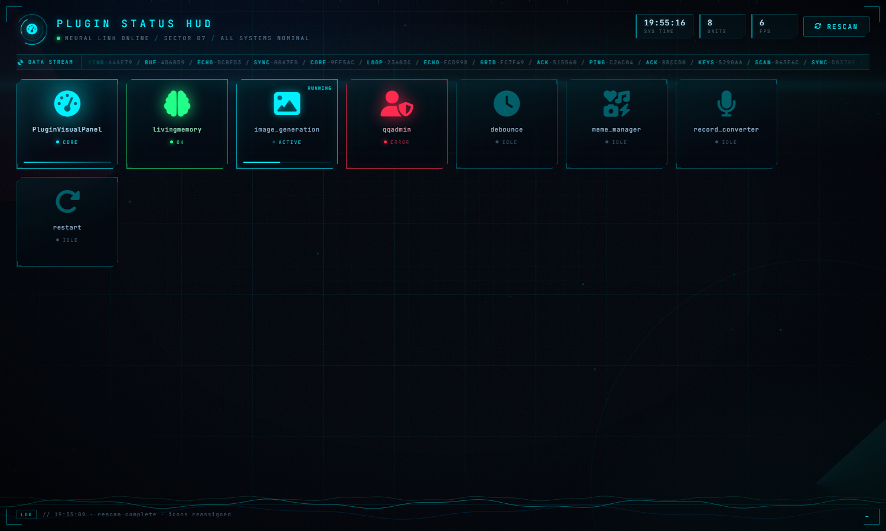

# 插件状态 HUD (PluginVisualPanel)

给 AstrBot 做一个深空风格的「插件运行状态仪表盘」。装了什么插件、哪个正在干活、跑到哪一步，一眼看完。



> 深蓝底 + 霓虹青 + 等宽字体，卡片按「调用频度 × 重要程度」自动排位，跑得越勤的越往上浮。

---

## 它做什么

- **自动拉取插件列表**：`context.get_all_stars()` 扫到的插件全部会上盘，不用手填。
- **生命周期上报**：挂的是 AstrBot 官方钩子，插件加载/卸载/报错都会即时变色。
- **链路可视化**：消息上下行、LLM 上行/下行、推理思考、工具循环、Shell、Python、检索等内置单元单独成卡。
- **四态动画**：空闲（灰）/ 运行（青，带进度环）/ 成功（绿）/ 失败（红）。
- **权重排序**：基础重要度 + 真实调用次数（每 8 次跳一档，避免卡片乱抖）。
- **点卡片改图标**：走 `/icon` 接口写进 `icon_overrides.json`，重启不丢。
- **手动刷新**：`/refresh` 重新扫描并重分配图标。

---

## 安装

要求 **AstrBot >= 4.25.3**，零第三方依赖（只用 `astrbot.api` 和标准库）。

```bash
cd AstrBot/data/plugins
git clone https://github.com/wey-gao/astrbot_plugin_visual_panel.git PluginVisualPanel
```

或者把 zip 解压到 `data/plugins/PluginVisualPanel/`，然后：

1. WebUI → 插件管理 → 重载插件（或重启 AstrBot）
2. 左侧栏会出现「插件状态 HUD」，点进去

目录结构必须是这个形状，`pages/hud` 名字不能改（和 metadata 里的 `pages` 对应）：

```
PluginVisualPanel/
├── main.py
├── metadata.yaml
└── pages/
    └── hud/
        ├── index.html
        ├── app.js
        └── style.css
```

---

## 已知问题与解决方法

### 1. 页面打开是黑的 / 接口 401

**原因**：早期版本在 `app.js` 里用裸 `fetch()` 调后端，没带 JWT，被 AstrBot 鉴权挡掉返回 401。

**解决**：已改成走 `AstrBotPluginPage.apiGet / apiPost`，会自动带 token。如果你自己改前端，别写裸 `fetch`，要么用这俩封装，要么自己从 `localStorage` 取 token 塞进 `Authorization`。

### 2. 图标全变成方块 / 页面无样式

**原因**：`index.html` 从 CDN 拉 FontAwesome 和 JetBrains Mono，拉不到就全变豆腐块。

**解决**：把这两个资源放到本地。改成：

```html
<link rel="stylesheet" href="./vendor/fontawesome/css/all.min.css">
<link rel="stylesheet" href="./vendor/fonts/jetbrains.css">
```

字体文件放 `pages/hud/vendor/` 下即可，纯静态不需要额外路由。

### 3. 大部分插件的灯一直是灰的

**原因**：本插件靠 **LLM 链路钩子** 点亮（`on_llm_request` / `on_llm_response` / `on_using_llm_tool` / `on_llm_tool_respond`）。走指令的插件（`/命令` 类，例如群管、签到）根本不经过这些钩子，自然不会亮，只在加载/卸载时闪一下。

**解决**（二选一）：

- 让那个插件自己在干活时喊一声（见下面「给自己的插件接上报」）；
- 或者把它的名字加进 `main.py` 的 `PERSIST_HINTS`，让它常亮。

### 4. 常亮判定认不出我的插件

**原因**：`PERSIST_HINTS` 是一张关键词表（认主、植入、人格、persona、loyalty…），命中才常亮，纯按名字字符串匹配。

**解决**：往 `PERSIST_HINTS` 里加自己的关键词，注意是**小写子串匹配**，插件名会被 `.lower()`。

### 5. 工具调用点亮的插件对不上号

**原因**：工具名 → 插件名靠 `TOOL_PLUGIN_HINTS` 反查，没配就落不到具体卡片上。

**解决**：在 `TOOL_PLUGIN_HINTS` 加一条 `(("你的工具名关键词",), "你的插件名")`。

### 6. 改了 `main.py` 但界面没变化

Python 模块已加载在内存里，光存盘没用。**重载插件**（WebUI → 插件管理 → 重载）或重启进程。

### 7. 图标名填了不显示

图标名必须是 **FontAwesome 6 Free 里真实存在的 Solid 图标**，写 `fa-gear` 或者 `gear` 都行，会自动补前缀；写了不存在的名字就退回默认齿轮。

### 8. 卡片位置老是跳

这是权重随调用次数上涨导致的。已经做了「每 8 次一档」的缓冲，嫌抖可以把 `weight` 公式里的 `min(30.0, ...)` 调小。

---

## 给自己的插件接上报

本插件实例挂在类属性 `PluginVisualPanel.instance` 上。别的插件想自己点亮卡片，可以这么找它（不依赖导入路径）：

```python
import sys

def get_hud():
    for m in list(sys.modules.values()):
        cls = getattr(m, "PluginVisualPanel", None)
        inst = getattr(cls, "instance", None) if cls else None
        if inst is not None:
            return inst
    return None

hud = get_hud()
if hud:
    hud._mark("你的插件名", "run")        # run / success / fail / idle
    hud._mark("你的插件名", "success")
```

`_mark(name, state, progress=None)`，`progress` 传 0~1 会在环上画进度弧。
`success` / `fail` 会自动衰减回 `idle`（见 `DECAY_SUCCESS` / `DECAY_FAIL`）。

### 加一个内置单元

`main.py` 顶部 `SYS_UNITS` 加一行就行，格式：

```python
("key", "显示名", "说明", "fa-图标", "分组", 权重)
```

分组目前是 `msg` / `model` / `tool` / `core`，前端按分组上色。

---

## 改动自己的图标（不用改代码）

点卡片右上角的笔直接改，最省事。

接口是 `POST /api/PluginVisualPanel/icon`，body：`{"name": "...", "icon": "fa-xxx"}`。
**注意这个接口走 AstrBot 的 JWT 鉴权**，用 curl 裸调会 401，想脚本化的话得先从页面 `localStorage` 里取 token 塞进 `Authorization` 头。

系统单元的 key 前缀是 `__sys__`（比如 `__sys__msg_in`），普通插件用插件真实 `name`。写入 `icon_overrides.json`，优先级高于默认值。

---

## 说明

- 状态轮询间隔 2 秒（`app.js` 里 `setInterval`），基本不耗 token——它只读内存，不调模型。
- 所有数据来自进程内状态，不写数据库，重启后计数清零。
- 只做了展示，不动任何插件行为。

## License

MIT
